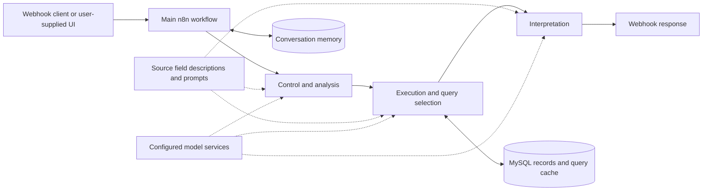

# Workflow Architecture

CropMaestro's released retrieval implementation runs in **n8n**, calling model services and MySQL with data-source-specific prompts. The commercial rice example uses `bus_rice_data`.

The hosted website is a separate application. Its screenshots/videos illustrate the service, but its frontend source is not included. A Webhook client can invoke the released workflow without that UI.

## Core retrieval path

The four layers cover task control, crop/field interpretation, SQL execution, and result interpretation. They are implemented by workflow nodes, not by the status API.

## Strategy and integration dependencies

- **Knowledge enhancement:** analysis can retrieve field-level knowledge from a configured vector collection. A Qdrant connection, populated source-specific collections, and a compatible embedding service are required. A populated index is not distributed.
- **Concurrent adversarial retrieval:** the main workflow calls the separately exported concurrent-search workflow. Import it and rebind the reference in your n8n instance before using `stableMode`.
- **Progress tracking:** `backend/status_api.py` receives status updates and exposes them for client polling. It does not run retrieval. Current callbacks are inline dependencies; run the helper or explicitly bypass those nodes.
- **GS prediction:** `backend/gs_predict_api.py` launches an optional extension. It is not needed for commercial rice text retrieval and requires separate model artifacts.
- **Optional logging:** the main workflow references a `Save process` workflow that is not distributed. Configure a compatible replacement or bypass it on the paths you use.

See [Workflow Setup](setup.md) for the node names and configuration steps.

## Data and runtime configuration

- `bus_rice_data`: commercial variety records supplied by the SQL dump.
- `bus_rice_cache_results`: query-result cache linked to session/query metadata.
- `chat_memory`: conversation history and query metadata.
- `request_status`: progress and confirmation information used by the status helper.

For commercial rice, file readers expect `/data/bus_rice_data.txt`, `/data/Mapping/bus_rice_mapping_data.txt`, and source-specific files under `/data/Prompt/`, including `rule/` and `unit/`. The combined `/data/hrmshcema.txt` reference is separate from the per-table descriptions.

The request carries flags under `config`, the session under `context`, and the question under `query`. `commercialMode` routes rice to the shipped commercial source, `expertMode` selects knowledge enhancement, and `stableMode` selects the Robust path.

## Extending a source

The [data-import tool](../tools/data_importer/) prepares source-specific tables and prompt packages from acquired tabular data. It does not alter n8n workflows, create a complete vector index, or supply the hosted frontend. Review field meanings and configure routing, file paths, model connections, and any vector collection for each source.

Each query uses its selected source. Different sources are not automatically harmonized or combined for joint filtering/ranking. The public commercial rice example and the five-crop CGR-Bench annotations have different data scopes.
